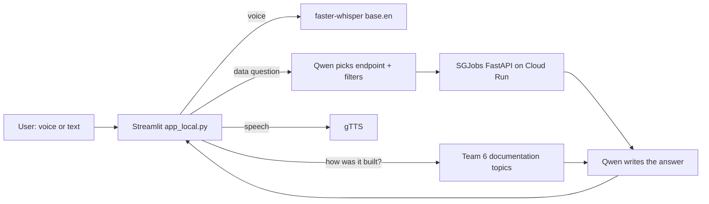

# SGJobs AI Chat - Hugging Face model in one Docker container

<!-- LINKS START -->
## Live links (updated 2026-10-11)

| What | Where it runs | Link |
|---|---|---|
| Streamlit dashboard (original, reads parquet) | Streamlit Community Cloud | https://sgjobs-app-dashboard-2zycahedjxbcetyeda3ut4.streamlit.app/ |
| FastAPI backend (15 endpoints) | Google Cloud Run | https://sgjobs-api-18035811102.us-central1.run.app/docs |
| Streamlit front end (calls the API) | Google Cloud Run | https://sgjobs-streamlit-18035811102.us-central1.run.app |
| React / JavaScript front end (calls the API) | Google Cloud Run | https://sgjobs-react-18035811102.us-central1.run.app |
| AI chat 1: Gemini analyst (voice + text) | Google Cloud Run + Vertex AI | https://sgjobs-ai-chat-18035811102.us-central1.run.app |
| AI chat 2: Qwen (Hugging Face) in one Docker container | Google Cloud Run | https://sgjobs-ai-hf-18035811102.us-central1.run.app |
| AI chat 3: Qwen (Hugging Face) on a laptop | Laptop + Cloudflare quick tunnel | https://pig-investigated-performing-seminar.trycloudflare.com (changes on every restart; only up while the laptop runs it) |

All three AI chats and both API front ends read the **same FastAPI backend**, so the same filters give the same figures.

| AI chat | Model | Speed | Cost |
|---|---|---|---|
| Gemini (Cloud Run) | Gemini 2.5 Flash, tool calling, several API calls per question | 3-5 s | cents per day of use |
| Qwen Docker (Cloud Run) | Qwen2.5-1.5B + faster-whisper baked into the image | 30-90 s, 1-2 min cold start | ~US$0.40/hour while a tab is open |
| Qwen laptop (tunnel) | same model via Ollama in Docker Desktop | 30-90 s | electricity only |
<!-- LINKS END -->

## What this folder is
The free, open-source version of the SGJobs AI chat, packaged as **one Docker image** and run on Google Cloud Run.
The same `app_local.py` also runs on a laptop behind a Cloudflare tunnel (see `../ai_chat/`).



## Files
| File | Purpose |
|---|---|
| `Dockerfile` | starts from `ollama/ollama`, adds Python, installs requirements, **bakes in** Qwen2.5-1.5B (1.1 GB) and Whisper so cold starts don't download them |
| `start.sh` | runs Ollama in the background, waits until it answers, then starts Streamlit on Cloud Run's `$PORT` |
| `app_local.py` | the chat app (copied from `../ai_chat/`) |
| `requirements_local.txt` | streamlit, requests, gTTS, faster-whisper |

## How the app answers
- **Concept questions** ("how was the data built?", "what are the 18 measures?", "why a category bridge?") are answered from
  Team 6's documentation only - no API call (the screen says so).
- **Data questions** - Qwen chooses the endpoint and filters, Python checks every filter value against `/api/filters`,
  the API returns JSON, Qwen writes the answer, and Python flags any number that is not in the data.

## Build and deploy
```bash
cd /mnt/c/SGJob_Project/sgjobs_decoupled_practice/ai_chat_hf
cp ../ai_chat/app_local.py .            # always copy the latest app first

gcloud builds submit \
  --tag us-central1-docker.pkg.dev/friendly-autumn-509313-n3/cloud-run-source-deploy/sgjobs-ai-hf \
  --timeout=40m --machine-type=e2-highcpu-8          # builds on Google's 8-CPU machine (~4 min)

gcloud run deploy sgjobs-ai-hf \
  --image us-central1-docker.pkg.dev/friendly-autumn-509313-n3/cloud-run-source-deploy/sgjobs-ai-hf \
  --region us-central1 --allow-unauthenticated \
  --cpu 4 --memory 4Gi --max-instances 1 --timeout 900 --cpu-boost
```
Building on the laptop (`docker build`) crashed WSL with a "Bus error" while Ollama and Streamlit were also running,
so the image is built in Cloud Build instead.

## Cost controls
```bash
# hide (private) between demos
gcloud run services remove-iam-policy-binding sgjobs-ai-hf --region us-central1 \
  --member=allUsers --role=roles/run.invoker
# public again
gcloud run services add-iam-policy-binding sgjobs-ai-hf --region us-central1 \
  --member=allUsers --role=roles/run.invoker
# delete completely
gcloud run services delete sgjobs-ai-hf --region us-central1
```

## Laptop + tunnel version (start-up order)
1. Docker Desktop -> wait for **Engine running** (ollama container green). Open WSL only after this.
2. Window 1: `cd .../ai_chat && conda activate sgjobs_test && python -m streamlit run app_local.py --server.port 8503`
3. Window 2: `/mnt/c/Users/neote/cloudflared tunnel --url http://localhost:8503` -> copy the new `trycloudflare.com` link.
Keep both windows open; the link changes every time the tunnel restarts.

## Limits (honest)
Qwen 1.5B on CPU is slow and sometimes garbles figures (the app flags numbers not found in the data). Use the Gemini
version for accuracy; this version shows the same chatbot can run with **zero AI cost and no data sent to an AI provider**.
